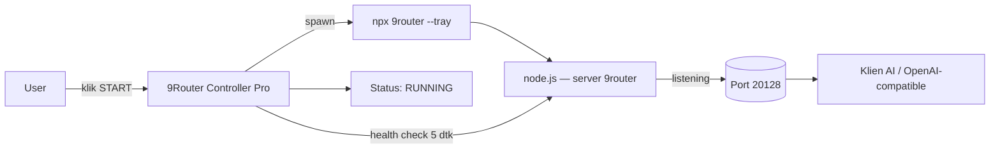

<div align="center">

# 🛰️ 9Router Controller Pro

### Komputer AI lokal, dalam satu tombol.

**GUI Windows untuk `npx 9router`** — menjalankan, memantau, dan menghentikan server 9router milikmu tanpa pernah menyentuh terminal.

[]()
[]()
[]()
[]()
[]()
[]()

**[🌐 Website](https://Maxodus126.github.io/9router-controller/)** · **[⬇️ Unduh](#-unduh)** · **[✨ Fitur](#-fitur)** · **[🚀 Cara Pakai](#-cara-pakai)** · **[🛠️ Pengembangan](#-pengembangan)** · **[❓ FAQ](#-faq)**

> 🖥️ Coba interaksi aslinya langsung di situs (START/STOP, Restart, Port Doctor) — demo hidup yang sama persis dengan aplikasinya.

</div>

---

**9Router Controller Pro** adalah aplikasi desktop yang membungkus `9router` — server AI lokal — menjadi antarmuka yang sederhana *dan jujur*. Bukan sekadar "proses ada/tidak": aplikasi ini benar-benar mengecek apakah API merespons, menampilkan status nyata, dan memberi kontrol penuh atas proses yang ia kelola.

Dibuat untuk orang yang ingin memakai AI lokal tanpa ribet dengan terminal, environment variables, atau proses yang berjalan diam-diam di background.

---

## ✨ Fitur

| | Fitur | Deskripsi |
|---|-------|-----------|
| ⚡ | **Start / Stop 1 klik** | Menjalankan `npx 9router --tray` tanpa jendela terminal. |
| 🟢 | **Status hidup jujur** | Health check tiap 5 detik → `RUNNING`, `DEGRADED`, `EXTERNAL`, `STOPPED`. |
| 🖥️ | **Live Console** | Seluruh stdout server mengalir dengan timestamp + tombol Clear. |
| 📋 | **Copy API URL** | Port terdeteksi otomatis dari banner 9router, bukan angka mati. |
| 🔄 | **Restart cepat** | Stop → start ulang dalam satu langkah. |
| 🩺 | **Port Doctor** | Pindai & bunuh proses pengunci port — selalu dengan konfirmasi dulu. |
| 🛡️ | **Auto-restart on crash** | Maks 3× berturut-turut, lalu menyerah dengan jujur. |
| 🪟 | **System tray + Run on Startup** | Hilang ke tray, bisa menyala saat boot — tanpa admin. |
| 🔒 | **Single-instance** | Hanya mengelola proses yang ia lahirkan sendiri. Tidak pernah menyentuh server asing. |
| 🔁 | **Update otomatis** | Tombol Update mengunduh & memasang versi baru secara senyap. |

---

## 📦 Unduh

| Opsi | File | Ukuran | Catatan |
|------|------|--------|---------|
| 🤖 **Installer lengkap** *(disarankan)* | [`9Router_Setup.exe`](9Router_Setup.exe) | ~57 MB | Node.js dibundel · per-user · tanpa admin · membuat shortcut |

> 💡 **Satu unduh, satu file, langsung jalan.** Semuanya sudah termasuk.
> <br>Alternatif: [GitHub Releases](https://github.com/Maxodus126/9router-controller/releases) · [situs produk](https://Maxodus126.github.io/9router-controller/).

---

## 🚀 Cara Pakai

### Prasyarat
- **Windows 10 / 11 (64-bit)**
- Internet sekali saat pertama START (unduh paket `9router` dari npm)
- Node.js **tidak wajib** — sudah dibundel

### Instalasi
```powershell
# 1. Unduh installer
# 2. Klik dua kali → Install
# 3. Buka 9Router Controller Pro → tekan START
```

### Alur kerja


Setelah START, app menunggu listener-nya sendiri (bukan sembarang proses di port itu), lalu menampilkan `RUNNING` + URL API yang bisa disalin. Tekan **STOP** → seluruh pohon proses yang dikelola dibunuh dengan rapi.

---

## 🛠️ Pengembangan

### Setup
```bash
git clone https://github.com/Maxodus126/9router-controller.git
cd 9router-controller
pip install -r requirements.txt   # customtkinter, pystray, psutil, pillow
```

### Menjalankan dari source
```bash
python app.py
```

### Build
```bash
# Exe (PyInstaller)
pyinstaller --onefile --windowed --collect-all customtkinter \
  --icon=app.ico --name 9RouterControllerPro app.py

# Installer (NSIS)
makensis installer.nsi             # → dist/9Router_Setup.exe
```

### Struktur proyek
```
.
├── app.py                  # Aplikasi utama (GUI + kontrol proses + updater)
├── installer.nsi           # Skrip NSIS (install/uninstall, bundle node)
├── 9RouterControllerPro.spec
├── EULA.txt
├── app.ico
├── _bundle/node/           # Node.js portable yang dibundel installer
├── dist/                   # Hasil build (exe + installer)
├── index.html              # Landing page (GitHub Pages)
└── 9Router_Setup.exe       # Installer rilis
```

### Teknologi
**Python 3 · Tkinter + customtkinter · pystray · psutil · PyInstaller · NSIS · Node.js (portable) · GitHub Pages**

---

## 🔁 Update Otomatis

Aplikasi menargetkan repositori ini dan mengunduh aset `9Router_Setup.exe` dari **GitHub Releases**:

1. Tombol **Update** → unduh installer baru ke `%TEMP%\9router_setup_update.exe`.
2. App menghentikan router-nya secara rapi (teardown penuh).
3. Installer dijalankan dengan `/S` (senyap), mengganti file, membuat ulang uninstaller.
4. Versi baru diluncurkan.

> Dirancang tanpa admin & tanpa memutus proses pengunci file.

---

## 📋 Changelog

### v1.1.0
- ✅ **Update otomatis** dari dalam aplikasi (self-update senyap).
- ✅ Perbaikan **stop-vs-start**: STOP tetap responsif saat layanan baru memulai.
- ✅ Guard `destroy` + teardown yang lebih aman saat keluar.

### v1.0.0
- ✅ Rilis awal: GUI lengkap, tray, health check, port doctor, auto-restart, installer NSIS.

---

## ❓ FAQ

**Apakah perlu menginstal Node.js?**
Tidak — installer membawa Node.js portable.

**Apakah butuh Administrator?**
Tidak. Terpasang per-user di `%LOCALAPPDATA%\Programs\9Router`.

**Bagaimana cara menghapus?**
Settings → Apps → **9Router Controller Pro → Uninstall** (atau Control Panel). Keluar dari aplikasi dulu agar pembersihan maksimal.

**Apa bedanya dengan `npx 9router` manual?**
App memberi kontrol penuh: Stop/Restart, live console, port doctor, auto-restart, startup saat boot, dan status kesehatan yang jujur.

**Apakah tersedia update otomatis?**
Ya — lihat [Update Otomatis](#-update-otomatis).

---

## 🤝 Kontribusi

PR, ide, dan laporan masalah sangat diterima.

- 🐞 **Laporkan bug:** [GitHub Issues](https://github.com/Maxodus126/9router-controller/issues)
- 🌐 **Situs produk:** <https://Maxodus126.github.io/9router-controller/>

**Panduan singkat:**
1. Fork & buat branch dari `master`.
2. Pastikan `python app.py` berjalan baik.
3. Buka Pull Request dengan deskripsi yang jelas.

---

## 📄 Lisensi

Hak cipta © 2026 Maxodus126. Proyek pribadi — seluruh hak dilindungi.
